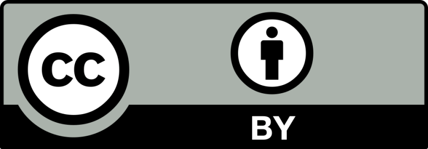

This work licensed under a Creative Commons Attribution 4.0 license. That means you can use it any way you like, including commercially, provided that you attribute it to me, Sven Semmler, and include a link to SvenSemmler.org.

[https://creativecommons.org/licenses/by/4.0/](https://creativecommons.org/licenses/by/4.0/)

Quotations and images are not included in this license; they are included either under a limitation or exception to copyright, or on the basis of a separate license. Please exercise caution.

I thought it best to use the exact formulation Cory Doctorow uses for [pluralistic.net](https://pluralistic.net/) in the hope it was vetted by legions of ultra-sharp [EFF](https://www.eff.org/) lawyers.