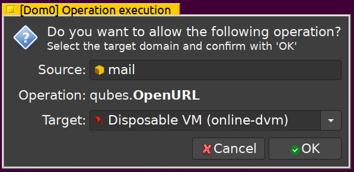

This page summarizes how to automate debian-minimal based template creation to enjoy the following advantages:

* documentation of your customizations
* easy and fast upgrade
* no need to backup templates

The recommended and more flexible way of doing this is to write [salt](https://www.qubes-os.org/doc/salt/) formula, while the more basic bash script based approach documented on this page works too and might be easier to understand. Obviously all the health warnings about running code in dom0 apply. In a nutshell: don't ever run any code that you don't trust. And the only way to truly trust code is to understand what it does.

### [The basics](#basics)

What follows is not intended to be a complete description of the commands introduced. Rather the aim is to explain the specific ways in which those commands are used later in this note. 

* `qvm-clone debian-11-minimal deb-11-min` ... creates an exact, complete and independent copy of debian-11-minimal called deb-11-min.

* `qvm-remove -f debian-11-minimal` ... completely deletes the debian-11-minimal qube without further prompts (no user interaction).

* `qvm-prefs deb-11-min` ... lists all the properties of the deb-11-min qube with their values. You can also add the property name like `qvm-prefs deb-11-min memory` to just list that one property and finally you can call `qvm-prefs deb-11-min memory 400` to set the property (in this case setting the qube's memory to 400).

* `qvm-shutdown --wait deb-11-min` ... will shutdown the deb-11-min qube and wait until it is off before returning. Without the `--wait` the qube will also be shutdown, but the command will return before that actually happened.

* `qvm-copy-to-vm deb-11-min ~/.gtkrc-2.0` ... will copy the .gtkrc-2.0 file from dom0 into the deb-11-min qube.

* `qvm-run --pass-io -u root deb-11-min "ls -la"` ... this allows you to run commands like 'ls -la' inside the deb-11-min qube and see the output (--pass-io) of it. The '-u root' argument tells qvm-run to execute the command as 'root'. Without it, the command is executed as 'user'.

Bash scripts are actually like programs, with control flow and conditional statements and the like. That's not how we will use it here though. These scripts are more like a recorded terminal session, with each line being one command. The only programming kind of thing we will use are variables. These are like placeholders:

```
#!/bin/bash

SOURCE_TEMPLATE=debian-10-minimal
TARGET_TEMPLATE=deb-10-min

qvm-template install $SOURCE_TEMPLATE
qvm-clone $SOURCE_TEMPLATE $TARGET_TEMPLATE
qvm-remove -f $SOURCE_TEMPLATE
```

In the first two lines we define two variables named SOURCE_TEMPLATE and TARGET_TEMPLATE and give them values. Then later in the script we can use those variables. This is especially useful if those scripts get longer and more involved and pretty much every line will at least reference the $TARGET_TEMPLATE qube. Note that the way to use a variable is to add the '$' sign in front of it. Now, if at a later time you want to use this script to download the debian-11-minimal tempalte, clone it into a deb-11-min and then do things to it, all you have to do is change the variables at the top of the script. 

Later we will also have little helper scripts that get called from other scripts. In that case, we want to be able to use parameters when calling the script. Like this:

```
add-feature-qt deb-11-min
```

Then inside the 'add-feature' script we can reference the first parameter given to it by using '$1'. The second parameter would be '$2' and so on.

And then there are comments. These are lines you can add to your script and leave yourself comments about what you are doing and why. These lines start with a hash ('#'). There is one special comment in the first line of every bash script, called the 'hash-bang'. That's this line:

`#!/bin/bash`

This comment is an old convention for all *nix shells to identify the interpreter to be used. In this case 'bash' aka "Bourne Again Shell". For our context here that's not important and your scripts will also work without it, but the aim here is to explain everything in the script so you can judge adequately whether you'd like to run it or not.

### [The idea](#idea)

The rough idea is to have bash scripts that download the Qubes OS provided debian-minimal template, clone and customize it and then create further, specialized clones for specific applications / use cases. A lot of steps will be common and therefore we will use two ways of addressing this:

1. our own min template ... all customization we want to have in all of our templates go in here. This is the template all others get cloned from and then further customized. Things like DPI settings, themes, and packages we want to have everywhere go here (e.g. sudoless root, shutdown-idle etc.) 

2. helper scripts ... some features like network, audio, file manager, QT or USB support will be desired in many but not all templates. Hence we create scripts like 'add-feature-audio' and 'add-feature-net' that can then be called from other scripts. This way, if at a later time such a 'feature' needs changes we can do it in one central place instead of having to search all our scripts for it.

### [Personal min template](#personal-min)

This script installs the Qubes OS provided minimal template, clones it and then customizes it. The below represents my own personal preferences, yours will be different. The key here is to show you the how and you then decide the what.

```
#!/bin/bash

SOURCE_TEMPLATE=debian-11-minimal
TARGET_TEMPLATE=deb-11-min

# download, clone and remove

qvm-template install $SOURCE_TEMPLATE
qvm-clone $SOURCE_TEMPLATE $TARGET_TEMPLATE
qvm-remove -f $SOURCE_TEMPLATE
```

Most of this was already explained in [the basics](#basics). First there is a call to qubes-dom0-update to install the qubes-template-debian-10-minimal package. Once that happened, the debian-10-minimal template is then cloned into deb-10-min and finally the debian-10-minimal template is removed again.

One could customize the actual debian-10-minimal template instead of cloning it, but I found it better to have a dedicated personal min template and leave the name used by the Qubes OS package (in this case debian-10-minimal) free to mean the unchanged as-provided-by-Qubes version of the template.

```
qvm-run --pass-io -u root $TARGET_TEMPLATE "rm -Rf /home/user/QubesIncoming"

# copy themes

qvm-copy-to-vm $TARGET_TEMPLATE /usr/share/themes/Yaru*

qvm-run --pass-io -u root $TARGET_TEMPLATE "rm -Rf /usr/share/themes/Yaru*"
qvm-run --pass-io -u root $TARGET_TEMPLATE "mv /home/user/QubesIncoming/dom0/* /usr/share/themes/"
qvm-run --pass-io -u root $TARGET_TEMPLATE "rm -Rf /home/user/QubesIncoming"

# copy icons

qvm-copy-to-vm $TARGET_TEMPLATE /usr/share/icons/Yaru*

qvm-run --pass-io -u root $TARGET_TEMPLATE "rm -Rf /usr/share/icons/Yaru*"
qvm-run --pass-io -u root $TARGET_TEMPLATE "mv /home/user/QubesIncoming/dom0/* /usr/share/icons/"
qvm-run --pass-io -u root $TARGET_TEMPLATE "rm -Rf /home/user/QubesIncoming"

# copy fonts

qvm-copy-to-vm $TARGET_TEMPLATE /usr/share/fonts/ubuntu

qvm-run --pass-io -u root $TARGET_TEMPLATE "rm -Rf /usr/share/fonts/truetype/ubuntu"
qvm-run --pass-io -u root $TARGET_TEMPLATE "mv /home/user/QubesIncoming/dom0/* /usr/share/fonts/truetype/"
qvm-run --pass-io -u root $TARGET_TEMPLATE "rm -Rf /home/user/QubesIncoming"
```

So this is our first test. :-) If you just copy & paste the above, chances are it won't work for you. The reason is that I personally prefer the Ubuntu Yaru theme and icon set as well as the Ubuntu font. Those are not part of Qubes OS and your dom0 won't have them. You can of course get them from a trusted source and copy them into your dom0 as I did, but that's a topic for another note or blog post. 

To make this work for you, replace the above mentions of 'Yaru' and 'Ubuntu' with whatever theme, icon set and font you have selected in your dom0 XFCE preferences. Alternatively to copying them from dom0, you could also install them into your personal min template, if they are in the debian repositories. However the end result will be the same and this way you can be sure you have the exact same files.

The qvm-copy-to-vm and qvm-run commands are explained in [the basics](#basics), so I'll focus only on the commands that run inside the qube:

1. QubesIncoming is the directory that receives the files when qvm-copy-to-vm is used.
2. 'rm -Rf' ... removes a folder with all subfolders and files in it
3. 'mv' ... moves files from a source to a destination

So what happens here is that we first make sure the destination is empty and then move the recieved files from the QubesIncoming folder to the intended destination. We have to do all of this as 'root' because the /user/share/... destination is only writeable for root.

```
# setup /etc/X11/Xresources/x11-common

qvm-run --pass-io -u root $TARGET_TEMPLATE 'echo "Xft.dpi: 156" >> /etc/X11/Xresources/x11-common'
qvm-run --pass-io -u root $TARGET_TEMPLATE 'echo "XTerm*faceName: Ubuntu Mono" >> /etc/X11/Xresources/x11-common'
qvm-run --pass-io -u root $TARGET_TEMPLATE 'echo "XTerm*faceSize: 11" >> /etc/X11/Xresources/x11-common'
qvm-run --pass-io -u root $TARGET_TEMPLATE 'echo "XTerm*background: #300a24" >> /etc/X11/Xresources/x11-common'
qvm-run --pass-io -u root $TARGET_TEMPLATE 'echo "XTerm*foreground: linen" >> /etc/X11/Xresources/x11-common'
```

In debian the file /etc/X11/Xresouces/x11-common holds your Xft.* definitions and others like the ones for XTerm can be added here too. This is entirely optional. But if you use a HiDPI screen, chances are you want to define your dpi value (ideally the same you selected in the XFCE preferences in dom0). The rest are just my personal perferences for fonts, size, fore- and background colors I want in XTerm. Adjust to your own preferences or skip this entirely.

The commands executed inside the qube here are `echo` and the `>>` operator. The first simple prints whatever was given to it. So `echo "Hello world!"` would simply print `Hello world!`. The `>>` operator takes whatever is printed on the terminal and appends it to the file given to it. So `echo "Hello world!" >> greetings.txt` would add a line 'Hello world!' to the end of the greetings.txt file.

We use this mechanism to append these lines to /etc/X11/Xresources/x11-common:

> Xft.dpi: 156<br>
> XTerm*faceName: Ubuntu Mono<br>
> XTerm*faceSize: 11<br>
> XTerm*background: #300a24<br>
> XTerm*foreground: linen

```
# rewrite URLS to use apt-cacher-ng

qvm-run --pass-io -u root $TARGET_TEMPLATE "sed -i -- 's/https:\/\//http:\/\/HTTPS\/\/\//g' /etc/apt/sources.list"
qvm-run --pass-io -u root $TARGET_TEMPLATE "sed -i -- 's/https:\/\//http:\/\/HTTPS\/\/\//g' /etc/apt/sources.list.d/*.list"
```

If you are using apt-cacher-ng then you want to add the above lines. If you never heard about apt-cacher-ng, then you don't use it and you SHOULD NOT add the above lines. They will break your updates if you do.

[`sed`](https://www.gnu.org/software/sed/manual/sed.html) is one of those super powerful *nix tools. It can parse text and then transform it. The argument `s/https:\/\//http:\/\/HTTPS\/\/\//g` given to it is a [regular expression](https://en.wikipedia.org/wiki/Regular_expression) that tells sed to look for `https://` and replace it with `http://HTTPS///`. 

```
# install basic packages

qvm-run --pass-io -u root $TARGET_TEMPLATE "apt update && apt full-upgrade -y"
qvm-run --pass-io -u root $TARGET_TEMPLATE "apt install qubes-core-agent-passwordless-root qubes-app-shutdown-idle -y"
```

Here we first update and upgrade the template in the first line and then install two packages in the second line.

* qubes-core-agend-passwordless-root ... makes it so you can simply use `sudo` within a qube without having to specify a password. If your blood is boiling now, [read this](https://www.qubes-os.org/doc/vm-sudo/) and if you still haven't come down [discuss here](https://forum.qubes-os.org/t/3517).

* qubes-app-shutdown-idle ... is a script that will shutdown a qube if it doesn't have any active windows for a set period of time. The script needs to be activated by calling `qvm-features` on a qube by qube basis. So just installing the package won't make it do anything. I dediced to make this part of my personal min template as I enable it in the majority of cases.

While I'd strongly recommend you to install `qubes-core-agent-passwordless-root` to make things work smoothly, the shutdown-idle script is entirely optional.

```
# set Xterm as default

qvm-run --pass-io -u root $TARGET_TEMPLATE "update-alternatives --set x-terminal-emulator /usr/bin/xterm"
```

I like XTerm, so I want it to be the default terminal in all my qubes. That's exactly what the above call to [`update-alternaives`](https://wiki.debian.org/DebianAlternatives) acomplishes.

```
# copy GTK configs and desktop shortcuts into /etc/skel

qvm-copy-to-vm $TARGET_TEMPLATE ~/bin/data/.gtkrc-2.0
qvm-copy-to-vm $TARGET_TEMPLATE ~/bin/data/settings.ini
qvm-copy-to-vm $TARGET_TEMPLATE ~/bin/data/qvm-open-in-vm-desktop.desktop

qvm-run --pass-io $TARGET_TEMPLATE "sudo mkdir -p /etc/skel/.config/gtk-3.0"
qvm-run --pass-io $TARGET_TEMPLATE "sudo mkdir -p /etc/skel/.local/share/applications"

qvm-run --pass-io $TARGET_TEMPLATE "sudo mv ~/QubesIncoming/dom0/.gtkrc-2.0 /etc/skel"
qvm-run --pass-io $TARGET_TEMPLATE "sudo mv ~/QubesIncoming/dom0/settings.ini /etc/skel/.config/gtk-3.0"
qvm-run --pass-io $TARGET_TEMPLATE "sudo mv ~/QubesIncoming/dom0/qvm-open-in-vm-desktop.desktop /etc/skel/.local/share/applications"
qvm-run --pass-io $TARGET_TEMPLATE "rm -Rf ~/QubesIncoming"

qvm-run --pass-io -u root $TARGET_TEMPLATE 'echo "xdg-settings set default-web-browser qvm-open-in-vm-desktop.desktop" >> /etc/skel/.bashrc'
```

There are three files I want to have in every home directory of every qube that gets created based on my templates:

* ~/.gtkrc-2.0 defines theme, iconset and font to be used for GTK-2 applications...

> include "/usr/share/themes/Yaru-dark/gtk-2.0/gtkrc"<br>
> style "user-font" <br>
> {<br>
>         font_name="Ubuntu"<br>
> }<br>
> widget_class "*" style "user-font"<br>
> gtk-font-name="Ubuntu 10"<br>
> gtk-theme-name="Yaru-dark"<br>
> gtk-icon-theme-name="Yaru"

* ~/.config/gtk-3.0/settings.ini defines theme, iconset and font to be used for GTK-3.0+ applications...

> [Settings]<br>
> gtk-font-name=Ubuntu 10<br>
> gtk-theme-name=Yaru-dark<br>
> gtk-icon-theme-name=Yaru

* ~/.local/share/qvm-open-in-vm-desktop.desktop is a desktop shortcut that I want to be set as default-web-browser. It's effect is that when a link is clicked in that qube, I get the Qubes OS dom0 dialog that allows me to select in which qube I want to open that link. 

> [Desktop Entry]<br>
> Encoding=UTF-8<br>
> Name=qvm-open-in-dvm<br>
> Exec=qvm-open-in-dvm %u<br>
> Terminal=false<br>
> X-MultipleArgs=false<br>
> Type=Application<br>
> Categories=Network;WebBrowser;<br>
> MimeType=x-scheme-handler/unknown;x-scheme-handler/about;text/html;text/xml;application/xhtml+xml;application/xml;application/vnd.mozilla.xul+xml;application/rss+xml;application/rdf+xml;image/gif;image/jpeg;image/png;x-scheme-handler/http;x-scheme-handler/https;

So just like before we are using `qvm-copy-to-vm` and standard `mv` and `rm` commands inside the qube to copy and then position the files. Finally we again use `echo` in combination with the `>>` operator to add this line to the /etc/skel/.bashrc file:

> xdg-settings set default-web-browser qvm-open-in-vm-desktop.desktop

This installs the desktop shortcut as the default web browser in that qube.

```
# shutdown
qvm-shutdown --wait $TARGET_TEMPLATE

qvm-prefs $TARGET_TEMPLATE memory 400
qvm-prefs $TARGET_TEMPLATE maxmem 0
```

Finally we use `qvm-shutdown --wait` to shutdown the template (which was automatically started the first time we used `qvm-run`). Then we set the `memory` property to 400 MB and the `maxmem` property to zero, which signals we do not want memory balancing.

### [building custom templates](#custom-templates)

Now that we have our personalized minimal template, we can write the first script for a dedicated tempalte. Let's start with the template for sys-net. This will introduce us to the remaining concepts, so that the rest of the guide can be less wordy and more of a reference nature.

```
#!/bin/bash

SOURCE_TEMPLATE=deb-11-min
TARGET_TEMPLATE=deb-11-net

# clone
qvm-clone $SOURCE_TEMPLATE $TARGET_TEMPLATE

# add features
add-feature-net               $TARGET_TEMPLATE
add-feature-net-manager       $TARGET_TEMPLATE
add-feature-net-rand-mac      $TARGET_TEMPLATE
add-feature-net-rand-hostname $TARGET_TEMPLATE

# shutdown
qvm-shutdown --wait $TARGET_TEMPLATE
```

By now it should be easy for you to understand what the above script does:

1. define variables for source and target tempaltes
2. clone from the source to the target
3. call a series of 'add-feature' helper scripts to be applied to the target
4. shutdown the target

This is how all the 'build' scripts will look. So going forward I'll simply describe the 'add-feature' helper scripts and then summarize recommendations how to combine them, like so:

#### library (calibre ebook management)

| feature(s)   | comment                                      |
|--------------|----------------------------------------------|
| calibre      | main application                             |
| file-manager | convinient handling of files (import/export) |
| net          | send emails from calibre                     |
| usb          | mount ebook reader                           |
| qt           | apply system style to calibre                | 
| ffmpeg       | allow for audiobook processing               |

### [features](#features)

In this section the 'add-feature' helper scripts I use and that have conceiable utility to you are listed. Obviously this can never be complete and is bound to not have the feature script you need. The whole point of this guide it to teach you the how, so you can take it from there.

First there are the dead simple ones, that simply install one or more packages. Those always look the the same. Here is the one for the 'audio' feature:

```
#!/bin/bash

echo +++ installing audio feature into $1
qvm-run --pass-io -u root $1 "apt install --no-install-recommends pulseaudio-qubes -y"
```

The `echo` line just prints the name of the feature to the terminal output so you can see what is happening at the moment. The second line calls `apt` as root (obviously) and add the `--no-install-recommends` parameter to make sure only dependencies that are truely required are installed. In this particular example only the `pulseaudio-qubes` package is required.

Here is a list of all those simple features and the packages they require:

| feature      | package(s)                       | comment 
|--------------|----------------------------------|---------
| audio        | pulseaudio-qubes                 |  
| net          | qubes-core-agent-networking      |
| net-manager  | qubes-core-agent-network-manager | 
|              | gnome-keyring                    | remember passwords
|              | firmware-iwlwifi                 | Intel WiFi firmware
| file-manager | nautilus                         | 
|              | qubes-core-agent-nautilus        | Qubes OS context menues 
|              | zenity                           | progress dialog
|              | libblockdev-crypto2              | handle encrypted drives
|              | exfat-fuse, exfat-utils          | handle ExFAT drives
|              | ntfs-3g                          | handle NTFS drives
|              | policykit-1                      | required for mounting
|              | eject                            | required for ejecting
| gpg          | qubes-gpg-split                  |
|              | scdaemon libccid pcscd           | GPG smart card
|              | pinentry-gtk2                    | PIN entry dialog
| pdf          | evince                           | viewer
|              | pdftk                            | pdf toolkit
| web          | google-chrome                    | 
| calibre      | calibre                          |
| keepassx     | keepassx                         |
| ffmpeg       | ffmpeg                           | 

Here some examples of feature scripts that do a bit more than just install packages:

#### usb

```
#!/bin/bash

echo +++ installing USB feature into $1
qvm-run --pass-io -u root $1 "apt install --no-install-recommends qubes-usb-proxy -y"

# allow USB webcams & microphones to be used without sudo
qvm-run --pass-io -u root $1 "usermod -a -G video user && usermod -a -G audio user"
```

The additional command at the end of the script adds the 'user' to the groups 'video' and 'audio', which is required so applications may use attached USB audio and video devices.

#### qt

```
#!/bin/bash

echo +++ installing QT theme support into $1
qvm-run --pass-io -u root $1 "apt install --no-install-recommends qt5-style-plugins gtk2-engines-murrine gnome-themes-standard -y"
qvm-run --pass-io -u root $1 'echo "QT_QPA_PLATFORMTHEME=gtk2" >> /etc/environment'
qvm-run --pass-io -u root $1 'echo "QT_SCALE_FACTOR=1" >> /etc/environment'
```

After installing the required packages to support QT styling to match the selected GTK theme, the script then adds two lines to the /etc/environment file:

> QT_QPA_PLATFORMTHEME=gtk2<br>
> QT_SCALE_FACTOR=1

Note: the scale factor of 1 works well in most cases, but e.g. with LibreOffice I have to set it to 0.8 for everything to match nicely. Some experimentation for your use cases might be needed here.

#### print

```
#!/bin/bash

echo +++ installing print feature into $1
qvm-run --pass-io -u root $1 "apt install --no-install-recommends hplip hplip-gui -y"
qvm-run $1 "sudo hp-setup"
```

This script is meant for HP printers and it will run the `hp-setup` program at the end. I find this useful, because I can then attach the actual printer USB to the template using the Qubes OS tray icon for this prupose. Then in the HP setup program I can discover and install the printer. This has the effect that all qubes that are based on this template, will be able to print to this device given the user assinged it to the qube in question via the tray icon. 

#### net-rand-hostname

```
#!/bin/bash

echo +++ installing randomized hostname feature into $1
qvm-copy-to-vm $1 ~/bin/data/00_hostname
qvm-run --pass-io -u root $1 "cp /home/user/QubesIncoming/dom0/00_hostname /etc/network/if-pre-up.d/"
qvm-run --pass-io -u root $1 "rm -Rf /home/user/QubesIncoming"
qvm-run --pass-io -u root $1 "chown root:root /etc/network/if-pre-up.d/00_hostname"
qvm-run --pass-io -u root $1 "chmod +x /etc/network/if-pre-up.d/00_hostname"
qvm-run --pass-io -u root $1 "touch /etc/hosts.lock"
```

Here is the contents of 00_hostname can be found on the on the [Qubes-Community](https://github.com/Qubes-Community/Contents/blob/master/docs/privacy/anonymizing-your-mac-address.md#randomize-the-hostname) website as well as an explanation of the above steps.

#### net-rand-mac

```
#!/bin/bash

echo +++ installing randomized MAC address feature into $1
qvm-copy-to-vm $1 ~/bin/data/00-macrandomize.conf
qvm-run --pass-io -u root $1 "cp /home/user/QubesIncoming/dom0/00-macrandomize.conf /etc/NetworkManager/conf.d/"
qvm-run --pass-io -u root $1 "rm -Rf /home/user/QubesIncoming"
```

Here is the contents of 00-macrandomize.conf can be found on the on the [Qubes-Community](https://github.com/Qubes-Community/Contents/blob/master/docs/privacy/anonymizing-your-mac-address.md#randomize-all-ethernet-and-wifi-connections) website as well as an explanation of the above steps.

#### office

```
#!/bin/bash

echo +++ installing libreoffice feature into $1
# libreoffice, QT interface to workaround GUI lag, spelling dictionaries, help, thesarus
qvm-run --pass-io -u root $1 "apt install libreoffice libreoffice-kf5 hunspell-en-us aspell-en wamerican wamerican-small wamerican-large libreoffice-help-en-us mythes-en-us -y"
qvm-run --pass-io -u root $1 'echo "SAL_USE_VCLPLUGIN=kf5" >> /etc/environment'
```

The packages in addition to libreoffice are the respective KDE interface (-kf5) as well as various spelling and thesaurus files I require. At the end of the script the following line is added to /etc/environment to tell LibreOffice to use the KDE interface:

> SAL_USE_VCLPLUGIN=kf5

This is necessary since there currently seems to be an issue with LibreOffice's GTK interface when used in Qubes OS. CPU load and scrolling speed are not satisfactory. Fortunately the KDE interface implementation for LibreOffice does not have this issue and it is trivially easy for us to select it instead.

### [templates](#templates)

Now finally a few examples...

#### library (calibre ebook management)

| feature(s)   | comment                                      |
|--------------|----------------------------------------------|
| calibre      | main application                             |
| file-manager | convinient handling of files (import/export) |
| net          | send emails from calibre                     |
| usb          | mount ebook reader                           |
| qt           | apply system style to calibre                | 
| ffmpeg       | allow for audiobook processing               |

(This is a work in progress, please subscribe to the [RSS feed](/feed.xml) so you get notified of updates to this page through my blog posts)